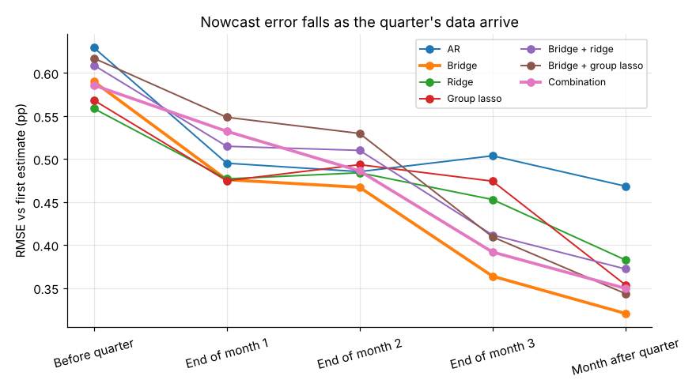

# Nowcasting UK GDP before ONS publishes it

*Executive summary. Details in the [model development document](model_development_document.md) and [validation report](validation_report.md).*

## The question

ONS publishes its first estimate of quarterly GDP about six weeks after the quarter ends. Can we estimate it earlier and reliably from the monthly data already published? And does modern regularised regression (ridge, lasso, elastic net, group lasso) on 39 indicators beat the simple "bridge equation" forecasters already use?

## How it was tested

A **pseudo-real-time backtest** of 76 quarters (2006–2026): every nowcast uses only the data that had been published by its date, including GDP and output figures *as first published*, read from ONS's real-time database and revisions triangles. Nowcasts are made at five points from the month before the quarter to two weeks before ONS's release. They are judged against ONS's first estimate. 15 models are compared, from the historical mean to partially penalised regressions with 236 candidate features.

## The answer

| When the nowcast is made | Best approach | Error (RMSE, pp of quarterly growth) | vs simple AR model |
|---|---|---|---|
| Before the quarter starts | elastic net / factor model | 0.55 | no better than the historical mean |
| End of month 1 | factor model, ridge, bridge | 0.46–0.48 | 4–7% better, not significant |
| End of the quarter | **bridge equation** (services + production output) | **0.36** | **28% better (p = 0.025)** |
| Two weeks before ONS | bridge equation | 0.32 | 32% better (p = 0.02) |

**Four findings:**

1. **Regularisation is necessary but not sufficient.** With more features than quarters, unrestricted regression is no better than guessing the average until the quarter ends. Ridge fixes that. But on its own, regularisation does not find a better signal than the two official output indexes.
2. **Official output data dominate.** Once ONS's monthly Index of Services and Index of Production for the quarter are out, a two-variable bridge equation is the most accurate model. Feeding 33 other indicators into it through ridge, lasso, elastic net or group lasso *raises* the error by 13–17%. More data is not better data.
3. **Real-time data are essential to an honest answer.** Run the same exercise the conventional way, on today's revised data, and the error two weeks before ONS falls from 0.32 to 0.17 pp. That backtest would claim twice the accuracy a forecaster could actually have had.
4. **The nowcast is as good as the target allows.** ONS later revises its first estimate by 0.37 pp on average (root mean square). The end-of-quarter nowcast misses the first estimate by 0.36 pp. Further gains against the first estimate will be small.

## Live nowcast (data to end-October 2026)

| Quarter | Nowcast (combination) | 80% interval | ONS first estimate |
|---|---|---|---|
| **2026Q3** | **+0.62%** | +0.15% to +0.88% | due 12 November 2026 |
| 2026Q4 | +0.48% | −0.07% to +0.84% | due February 2027 |

## Recommendations

1. **Use the bridge-anchored combination as the quarter-end nowcast, with the plain bridge alongside.** They are statistically indistinguishable, and the combination is less exposed to a single late or revised series.
2. **Early in the quarter, report a range, not a point.** No model meaningfully beats the historical mean before the quarter starts. Ridge and the factor model give the best early read, and the error is about ±0.5 pp.
3. **Spend effort on timelier data, not more complex models.** The binding constraint is information, not the estimator. Licensed business surveys and real-time vintages of retail and trade data are the next step.
4. **Judge nowcasts against first estimates and revisions together.** An error of 0.36 pp is about the size of ONS's own revisions.

*Data: ONS (GDP real-time database, revisions triangles, monthly GDP, production, retail, trade, labour market and prices), Bank of England (interest rates, sterling, mortgages, money). Open Government Licence v3.0.*
