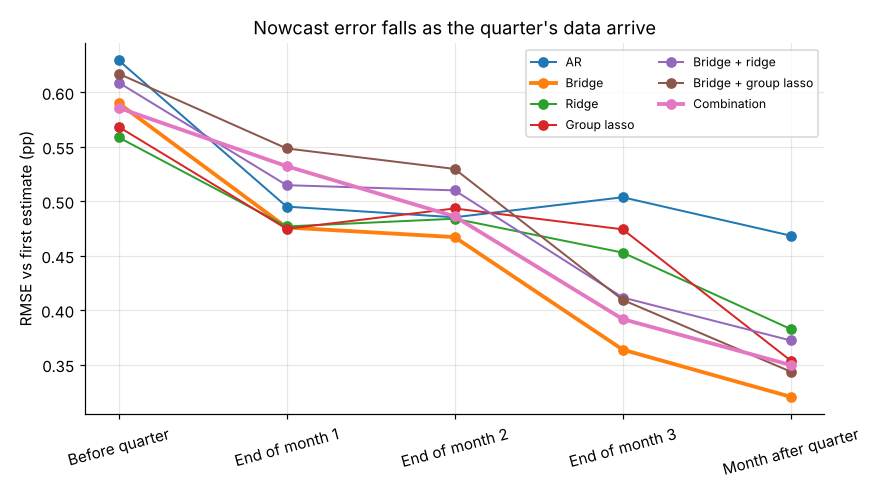
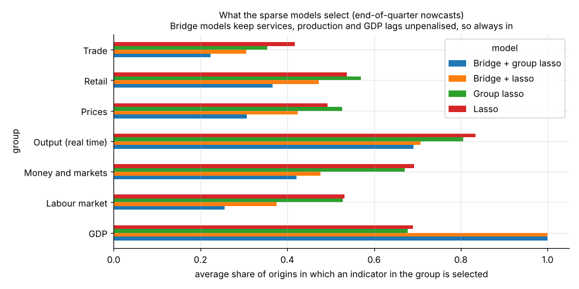

# Model development document: real-time nowcasting of UK GDP

*Version 1.0, November 2026. Code: `src/nowcast/`. Results: `outputs/tables/`. Independent checks: [validation report](validation_report.md).*

## 1. Purpose and scope

**Business question.** How accurately can quarter-on-quarter growth of UK real GDP be estimated before the Office for National Statistics (ONS) publishes its first estimate, which indicators carry the signal, and does regularised regression on a wide panel of monthly indicators beat the simple models that forecasters already use?

**Users.** Teams who need a GDP number before ONS does: central bank and HM Treasury forecasters, bank and asset-manager economists, and risk teams who feed GDP into credit, liquidity or stress models (for example the [UK credit stress engine](https://github.com/TilakHeble/uk-credit-stress-engine)).

**Target.** Quarter-on-quarter growth of chained-volume GDP (ONS series ABMI), in percent. The main evaluation target is ONS's **first estimate**, which is what markets react to. The latest estimate is used as a second target.

**Out of scope.** Point forecasts more than one quarter ahead, GDP components (consumption, investment) and private survey data (PMIs and CBI surveys are licensed and cannot be redistributed).

## 2. Why regularised regression

A nowcast has to combine many monthly indicators, each observed with several lags, using a short history of quarters. The main specification has **236 candidate features**: 39 indicators × 6 monthly lags, plus 2 GDP lags. It is trained on **31 quarters at the first origin and 107 at the last**. With more features than observations, ordinary least squares has no unique solution and interpolates the training data. Regularisation gives a unique, stable solution by trading a little bias for a large cut in variance:

| Estimator | Penalty | What it assumes about the signal |
|---|---|---|
| Ridge | λ‖β‖²₂ | dense: many small effects; shrinks correlated predictors together |
| Lasso | λ‖β‖₁ | sparse: a few indicators matter; sets the rest exactly to zero |
| Elastic net | λ(α‖β‖₁ + (1−α)/2‖β‖²₂) | sparse but grouped: selects correlated indicators together |
| Adaptive lasso | λΣ wⱼ\|βⱼ\|, wⱼ = 1/\|β̂ⱼ(ridge)\| | sparse, with less bias on large effects (oracle property) |
| Group lasso | λΣ_g √p_g ‖β_g‖₂ | sparse at the *indicator* level: all six lags of an indicator enter or leave together |

Two further classes are benchmarks:
* **Factor model (diffusion index, Stock and Watson 2002).** Regresses GDP on the first *k* principal components of the indicators. Like ridge, it assumes a dense signal, but it compresses before regressing. The [learn notebook 07](../learn/07_regularisation_vs_factors.ipynb) shows that principal-components regression and ridge are two ways of shrinking along the same singular directions.
* **Bridge equation.** OLS of GDP growth on the latest three months of the ONS Index of Services and Index of Production (which together make up GDP's output measure), plus GDP lags. This is the traditional approach in central banks and the benchmark to beat.

**Partially penalised ("bridge-anchored") models.** In these models the bridge regressors are left unpenalised and only the other indicators are regularised. By the Frisch–Waugh–Lovell theorem, this is the penalised model fitted to y and Z₂ after both are residualised on [1, Z₁]. The question these models answer is the practical one: *given that we already have a bridge equation, do the other 33 indicators add anything once they are regularised?*

**Forecast combination.** An equal-weight average of the five bridge-anchored models. The weights were fixed before the anchored models were evaluated, so the combination is not chosen with hindsight.

## 3. Data

| Source | Content | Real-time history |
|---|---|---|
| ONS GDP real-time database (ABMI) | every published estimate of quarterly GDP since 1961 | yes: one column per publication |
| ONS revisions triangles | monthly growth of the Index of Services, Production and Manufacturing as published each month | yes: Index of Production from 1998, Index of Services from 2001 |
| ONS time-series datasets: `mgdp`, `diop`, `drsi`, `mret`, `lms`, `mm23` | monthly GDP by industry, manufacturing detail, retail sales, trade, labour market, prices | latest vintage only |
| Bank of England database | Bank Rate, gilt yields, sterling, mortgage rates and approvals, M4 | latest vintage (market data are not revised) |

All data are published under the Open Government Licence v3.0 and downloaded by `python scripts/run_pipeline.py --data`.

**Indicator catalogue** (`src/nowcast/config.py`, 74 indicators):

| Group | Indicators | Used in |
|---|---|---|
| Output (real time) | Index of Services, Production, Manufacturing, as first and subsequently published | main |
| Retail | volumes, ex fuel, online, fuel | main |
| Trade | goods and services exports and imports, ex-erratics, cars, capital goods | main |
| Labour market | unemployment, employment, hours, inactivity, second jobs, vacancies, earnings | main |
| Prices | CPI, services CPI, CPI, core and RPI inflation | main |
| Money and markets | Bank Rate, 5- and 10-year gilts, term spread, sterling (ERI and $), mortgage rate, approvals, M4 | main |
| Output (latest vintage) | monthly GDP and its 21 industries | look-ahead experiment only |
| Manufacturing detail (latest vintage) | 13 manufacturing industries | look-ahead experiment only |

**Transformations.** Indexes and levels use 100 × monthly log change. Rates use the monthly change, except rates that are already growth rates (inflation), which enter as levels. Each feature is standardised with the training-sample mean and standard deviation at every origin.

## 4. Real-time design

This is what separates the project from the usual "nowcasting" exercise, which fits models to today's revised data and so overstates accuracy.

**Nowcast origins.** For target quarter Q, nowcasts are made at the end of five months T(Q, h) = first month of Q + h:

| h | Origin | Typical information |
|---|---|---|
| −1 | end of the month before Q | one-quarter-ahead forecast; no data on Q |
| 0 | end of month 1 | financial data and prices for month 1 |
| 1 | end of month 2 | + retail and labour data for month 1 |
| 2 | end of month 3 (quarter end) | + output data for month 1 |
| 3 | end of the month after Q | + output for month 2; ~2 weeks before the first estimate (2018 onwards only) |

**Information set at each origin.**
* **The ragged edge.** Indicator *i* is known up to month T − lagᵢ, its publication lag. The features are the six latest *available* months. Lags are fixed, so feature `CODE_l0` always refers to the same month relative to the quarter, and one model is estimated per horizon (unrestricted MIDAS, Foroni, Marcellino and Schumacher 2015).
* **GDP lags** come from the latest vintage published by T. Growth in Q−1 is missing when it is not yet published and is imputed by the pipeline.
* **Real-time output** values are read from the vintage of the revisions triangle in force at T, so the model sees the Index of Services *as first published*, not as revised years later.
* **Training sample.** Quarters whose first estimate was published by T (COVID quarters 2020Q1–2021Q2 excluded from training, never from evaluation). The training target is the first estimate, so the model learns to predict the number it is judged against.

**Look-ahead check.** Unit tests (`tests/test_features.py`) confirm that a real-time lookup returns the vintage in force at the origin, and that features never use months after T − lag.

## 5. Estimation and tuning

* **Penalty selection.** Blocked, expanding-window time-series cross-validation (5 folds, each validating on the block of quarters that follows its training data). The penalty that minimises mean validation error is chosen; the one-standard-error rule is a robustness variant. Shuffled K-fold CV would leak future information through autocorrelated indicators ([learn notebook 05](../learn/05_choosing_lambda.ipynb)).
* **Grids.** Ridge: 60 values from 10⁻² to 10⁶. Lasso: a 60-value scikit-learn path. Elastic net: 40 values for each mixing weight α ∈ {0.1, 0.3, 0.5, 0.7, 0.9, 0.99}. Adaptive lasso: weights from the CV-tuned ridge fit, then a 60-value lasso path on the rescaled columns. Group lasso: 25 values from λ_max down to λ_max/316, solved by accelerated proximal gradient descent (FISTA) with warm starts, implemented from scratch. Factor model: k = 1–8 chosen by the same CV.
* **Missing values** are set to the training mean (0 after standardisation), so a missing feature contributes nothing.

## 6. Evaluation design

* **Out-of-sample period.** 2006Q1 to the latest published quarter. Every nowcast is made with an expanding window from 1998Q1, using only data available at its origin.
* **Metrics.** RMSE against the first estimate (main) and the latest estimate. Relative RMSE against the AR benchmark. Accuracy by sub-period (financial crisis, 2010s, post-COVID).
* **Significance.** Diebold–Mariano test of equal squared-error loss with the Harvey–Leybourne–Newbold small-sample correction. Each nowcast is a one-step forecast evaluated once, so no autocorrelation terms are used.
* **Uncertainty.** 80% intervals from the empirical 10th and 90th percentiles of each model's past errors (last 40 quarters, only errors whose outcome was known at the time). Coverage is checked out of sample.
* **Selection stability.** Share of origins in which each indicator is selected by the sparse models.
* **Robustness variants.** (1) Latest-vintage output data instead of real time: the size of the look-ahead flattery. (2) No output or trade data (early indicators only). (3) COVID quarters included in training. (4) A 40-quarter rolling window. (5) The one-standard-error rule. (6) A conventional backtest using today's revised data as inputs, training target and yardstick, to measure look-ahead flattery.

## 7. Results

### 7.1 Accuracy by horizon

RMSE against the ONS first estimate, in percentage points of quarterly growth. COVID quarters are excluded. Horizons −1 to 2 cover 76 quarters (2006Q1–2026Q2); the month after the quarter covers 27 quarters (2018Q3 onwards). Source: `outputs/tables/rmse_first_estimate.csv`.

| Model | Before quarter | End of month 1 | End of month 2 | End of month 3 | Month after |
|---|---|---|---|---|---|
| Mean | 0.556 | 0.550 | 0.549 | 0.549 | 0.378 |
| AR | 0.629 | 0.495 | 0.485 | 0.504 | 0.468 |
| **Bridge** | 0.590 | 0.476 | 0.467 | **0.364** | **0.320** |
| OLS (all 236 features) | 0.601 | 0.550 | 0.562 | 0.503 | 0.388 |
| Ridge | 0.559 | 0.477 | 0.484 | 0.453 | 0.383 |
| Lasso | 0.559 | 0.528 | 0.522 | 0.498 | 0.405 |
| Elastic net | **0.549** | 0.495 | 0.497 | 0.485 | 0.414 |
| Adaptive lasso | 0.567 | 0.535 | 0.566 | 0.512 | 0.475 |
| Group lasso | 0.568 | 0.475 | 0.493 | 0.474 | 0.354 |
| Factor | **0.549** | **0.460** | 0.474 | 0.463 | 0.447 |
| Bridge + ridge | 0.609 | 0.515 | 0.510 | 0.412 | 0.372 |
| Bridge + lasso | 0.610 | 0.609 | 0.543 | 0.417 | 0.361 |
| Bridge + elastic net | 0.623 | 0.599 | 0.514 | 0.424 | 0.388 |
| Bridge + group lasso | 0.617 | 0.548 | 0.530 | 0.409 | 0.343 |
| Bridge + factors | 0.596 | 0.480 | **0.458** | **0.359** | 0.334 |
| Combination | 0.586 | 0.532 | 0.486 | 0.392 | 0.350 |

**Findings**

1. **Regularisation does its job against overfitting.** With 236 features and 31–107 quarters, unrestricted (minimum-norm) OLS is no better than the sample mean until the quarter ends. Ridge beats it at every horizon, by 10% at the end of the quarter (0.453 vs 0.503).
2. **Before output data arrive, regularised and factor models are the best available, but the gain is small.** At the end of month 1 the factor model (0.460), group lasso (0.475), ridge (0.477) and bridge (0.476) are 4–7% better than AR, and none of these differences is significant (Diebold–Mariano p > 0.25). Before the quarter starts, no model beats the historical mean by more than 1.5%.
3. **Once the quarter's output data are published, the bridge equation wins, and the other indicators add nothing.** At the end of month 3 the bridge's RMSE is 0.364, 28% below AR (DM p = 0.025). Adding the other 33 indicators through ridge, lasso, elastic net or group lasso raises the error by 13–17% relative to the bridge (DM p between 0.06 and 0.16). Only the factor version (Bridge + factors, 0.359) matches the bridge.
4. **The nowcast error is now about the size of ONS's own revisions.** The root mean square revision between ONS's first and latest estimates over the same quarters is 0.365 pp. The best end-of-quarter nowcasts (0.36) are about as close to the first estimate as the first estimate is to the eventual truth.

### 7.2 Significance

Diebold–Mariano tests against AR (`outputs/tables/dm_vs_ar.csv`) and against the bridge (`dm_vs_bridge.csv`):

| Comparison | End of month 3 | Month after quarter |
|---|---|---|
| Bridge vs AR | rel. RMSE 0.72, p = 0.025 | 0.68, p = 0.019 |
| Bridge + factors vs AR | 0.71, p = 0.023 | 0.71, p = 0.009 |
| Combination vs AR | 0.78, p = 0.065 | 0.75, p = 0.018 |
| Ridge vs bridge | 1.25, p = 0.037 (bridge better) | 1.19, p = 0.40 |
| Lasso vs bridge | 1.37, p = 0.004 (bridge better) | 1.26, p = 0.25 |
| Bridge + factors vs bridge | 0.99, p = 0.57 | 1.04, p = 0.43 |

No regularised model is significantly better than AR at any horizon before output data arrive. Every pure regularised model is significantly *worse* than the bridge at the end of the quarter.

### 7.3 Stability across periods (end of month 3)

| Model | 2006–2009 | 2010–2019 | 2021Q3–2026 |
|---|---|---|---|
| Mean | 0.920 | 0.390 | 0.405 |
| AR | 0.641 | 0.434 | 0.508 |
| Bridge | 0.361 | **0.360** | **0.373** |
| Ridge | 0.498 | 0.423 | 0.472 |
| Lasso | 0.619 | 0.472 | 0.438 |
| Factor | 0.566 | 0.382 | 0.517 |
| Bridge + factors | **0.299** | 0.370 | 0.379 |
| Combination | 0.332 | 0.420 | 0.377 |

The bridge's advantage is not a financial-crisis artefact: it is best or close to best in every period. Regularisation helps most when the target moves most (2006–09), which is when the mean is worst. Since COVID, quarterly growth has been so stable that the mean is hard to beat early in the quarter.

### 7.4 What the sparse models select

At the end of the quarter, the plain lasso keeps a median of 37 of 236 features, the elastic net 74 and the group lasso 146 (about 24 indicators). Selection frequencies across the 82 end-of-quarter origins, including the six COVID quarters (`outputs/tables/selection_frequency.csv`):

* **Real-time Index of Production and Index of Services** are selected in 85–90% of lasso fits: the same information the bridge uses.
* **Bank Rate changes** are selected in every lasso fit. This is mostly the 2008–09 cuts, which coincided with the deepest fall in output, so it is a crisis signal rather than a stable monthly relationship.
* **Labour-market indicators** (vacancies, unemployment) and money (M4) are selected in 80–85% of fits, but they add no accuracy once output data are in.
* The elastic net chose α = 0.1 (mostly ridge) in 47% of fits and α = 0.99 in 24%. Cross-validation could not consistently tell whether the signal is dense or sparse, which is itself evidence that the extra indicators carry little signal.

### 7.5 Uncertainty

80% intervals built from each model's own past errors cover the first estimate 71–87% of the time at horizons −1 to 2, close to the 80% target (`outputs/tables/interval_coverage_80.csv`). At the month after the quarter, coverage ranges from 57% to 93% across models over only 27 quarters. For the bridge and Bridge + factors it is 57%. An interval needs 12 past errors, so at this horizon intervals exist only from about 2022 and are built from very few errors. Treat month-after intervals for the bridge-type models as too narrow.

### 7.6 Against the latest estimate

Judged against today's revised GDP (`rmse_latest_estimate.csv`), every error is larger (the target includes later revisions), but the ranking holds: bridge 0.427 and Bridge + factors 0.425 at the end of the quarter, against ridge 0.487 and AR 0.580. One difference: early in the quarter, ridge is the most accurate model for the eventual truth (0.518 at the end of month 1, against 0.570 for the bridge and 0.636 for the mean).

### 7.7 Robustness

Each variant re-runs the full 361-origin backtest (`outputs/tables/robustness.csv`, `lookahead.csv`, [notebook 06](../notebooks/06_robustness_and_lookahead.ipynb)). Changes are relative to the main design's RMSE against the first estimate.

| Variant | Effect |
|---|---|
| Early indicators only (no output or trade data) | Ridge's error falls only from 0.55 to 0.47 over the quarter, against 0.59 to 0.36 for the bridge. Late-quarter accuracy comes from official output data. |
| COVID quarters in training | Pure regularised models get much worse early in the quarter (lasso +56%, group lasso +55% at the end of month 1). Bridge-type models improve once output data arrive (bridge −9% at quarter end, −15% in the month after), because 2020's swings pin down the output–GDP mapping. |
| Rolling 40-quarter window | AR and ridge gain up to 9%. The bridge loses 4–29%, and the anchored models up to 81%, once the window drops 2008–09. |
| One-standard-error rule | Bridge-anchored models improve 6–17%: Bridge + ridge 0.364 (equal to the bridge) and Bridge + group lasso 0.353 (3% better than the bridge, not tested for significance) at quarter end. The pure regularised models mostly get worse. |
| Revised output data, judged against the first estimate | Bridge error *rises* 23% at quarter end and 8% in the month after. ONS builds its first estimate from first-published output, so revised data are the wrong input. |
| Conventional backtest (revised data as inputs, target and yardstick) | Reports a month-after-quarter bridge error of 0.169 pp, against 0.320 pp achievable in real time, and a 77% gain over AR instead of 32%. |

**Conclusions.** In every variant that includes output data, the most accurate end-of-quarter model is the bridge or a bridge-anchored model, and the best pure regularised model trails it by 6–47%. The one variant where regularisation adds to the bridge (heavier penalties, Bridge + group lasso) is a candidate for the next model version. It is not adopted here, because it was found by looking at the evaluation results. The look-ahead experiment shows why real-time data matter: a conventional backtest would roughly halve the reported late-quarter error.

### 7.8 Live nowcast

Nowcasts made with data published by the end of October 2026 (`outputs/tables/live_nowcast.csv`):

| Quarter | Horizon | Combination | 80% interval | Bridge | AR |
|---|---|---|---|---|---|
| 2026Q3 | month after quarter | **0.62%** | 0.15% to 0.88% | 0.65% | 0.44% |
| 2026Q4 | end of month 1 | **0.48%** | −0.07% to 0.84% | 0.49% | 0.37% |

ONS publishes its first estimate for 2026Q3 on 12 November 2026.

### 7.9 Model selection

The **production model is the combination of the five bridge-anchored models**, with the plain bridge reported alongside. The bridge is marginally more accurate, but the difference is not significant, and the combination is less exposed to a single series being revised or late. Before the quarter's output data arrive, the factor model and ridge are reported as the early read. No model's nowcast should be presented without its interval.

## 8. Limitations

* **Some indicators are latest vintage.** Retail, trade and labour-market data are revised modestly after publication. Only the output data, the most heavily weighted, are fully real time. The look-ahead experiment measures the effect for output data; the effect for the rest is likely smaller.
* **No surveys.** PMIs, CBI and Lloyds business barometers are the most timely UK indicators but are licensed. The early-month nowcasts would gain most from them.
* **Short real-time output history.** The Index of Services triangle starts in 2001, so models trained early in the sample have few observations, and h = 3 nowcasts exist only from 2018 (before then the first estimate came out before that origin).
* **COVID.** Quarters 2020Q1–2021Q2 are excluded from training. Their errors are reported separately, because one quarter (2020Q2, −19%) would dominate any RMSE.
* **CV inside partially penalised models.** The residualisation on the bridge regressors uses the whole training sample before CV folds are formed. This affects penalty choice only, never the out-of-sample nowcast.

## 9. References

* Bańbura, M., Giannone, D., Modugno, M. and Reichlin, L. (2013). Now-casting and the real-time data flow. *Handbook of Economic Forecasting*, 2A.
* Diebold, F. X. and Mariano, R. S. (1995). Comparing predictive accuracy. *Journal of Business and Economic Statistics*, 13(3).
* Foroni, C., Marcellino, M. and Schumacher, C. (2015). Unrestricted mixed data sampling (MIDAS). *JRSS A*, 178(1).
* Harvey, D., Leybourne, S. and Newbold, P. (1997). Testing the equality of prediction mean squared errors. *IJF*, 13(2).
* Stock, J. H. and Watson, M. W. (2002). Macroeconomic forecasting using diffusion indexes. *JBES*, 20(2).
* Tibshirani, R. (1996); Zou, H. and Hastie, T. (2005); Zou, H. (2006); Yuan, M. and Lin, Y. (2006): lasso, elastic net, adaptive lasso, group lasso.
